# Rivers of Bangladesh — 3D map, history and community

An interactive map of the rivers that shape Bangladesh: 3D terrain with river paths, the history behind each one, and a community layer — blog posts, discussion and an admin dashboard for maintaining it.

`CesiumJS` · `React` · `KML / KMZ` · `Supabase` · `Vercel`

🌐 Live: https://rivers-of-bangladesh-six.vercel.app

---

## The idea

River data in Bangladesh usually exists in two incompatible forms: serious geospatial files nobody outside GIS can open, and blog posts with no geography at all. This project puts both on one screen — click a river on the 3D globe to read its history, its course and its present condition, then talk about it in the forum attached to it.

## Features

- **3D globe view** with river courses loaded from KML/KMZ files, so the source data stays in the format hydrologists and mapping tools produce.
- **River pages** — course, length and significance, written for a general reader rather than a gazetteer.
- **Community** — blog posts and threads tied to a river, so a discussion keeps its geography.
- **Accounts** — sign up, sign in, permissions.
- **Admin dashboard** — manage rivers, posts and threads without editing code.
- **Responsive layout** — the globe is usable on a phone, not just a desktop.

## Repository layout

```
README.md
River Files/Mahananda Basin.kml
River Files/Nilphamari District.kml
River Files/Nilphamari District.kmz
River Files/NilphamariPaths.json
River Files/view-mahananda-river-bangladesh-with-boats_595440-1477.jpg
Website UI/admin_dashboard/code.html
Website UI/admin_dashboard/screen.png
Website UI/community_forum/code.html
Website UI/community_forum/screen.png
Website UI/interactive_map_explorer/code.html
Website UI/interactive_map_explorer/screen.png
Website UI/interactive_map_explorer_animated/code.html
Website UI/interactive_map_explorer_animated/screen.png
```


## Run it

```bash
npm install
npm run dev
```

Environment variables for the Supabase project go in `.env.local`:

```
VITE_SUPABASE_URL=...
VITE_SUPABASE_ANON_KEY=...
```

The anon key is a publishable key; every table must have Row Level Security enabled, with writes restricted to authenticated authors and admins.

## Limitations

- Large KML files are loaded directly, so the first paint of a dense river network depends on the connection.
- Terrain detail comes from the globe provider's free tier; it is not survey-grade.
- Content is editorial, not a scientific dataset — treat the write-ups as an introduction and follow the sources if you need accuracy.

---

**Md. Abir Ul Islam** · [GitHub](https://github.com/abir2022) · [LinkedIn](https://www.linkedin.com/in/md-abir-ul-islam/)
